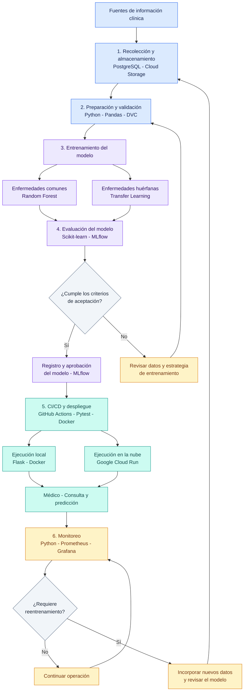
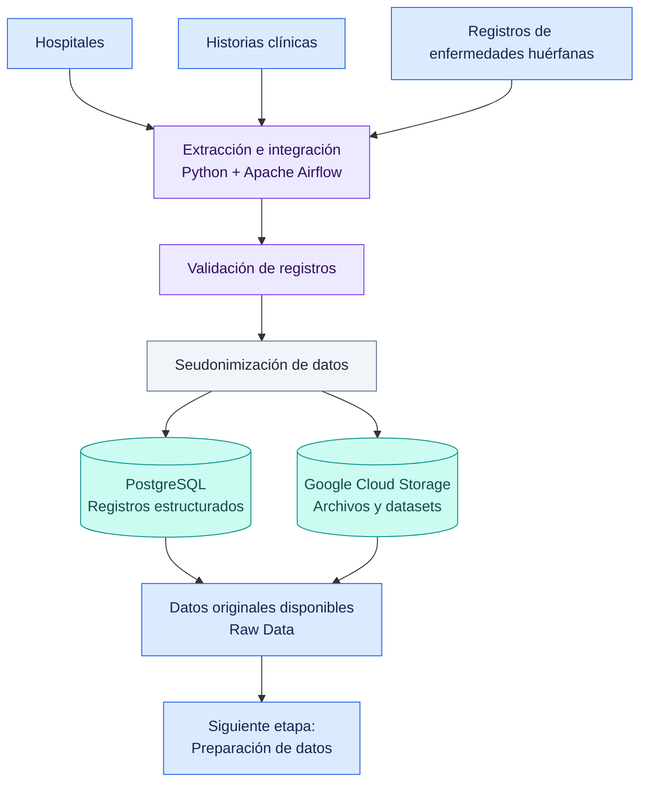
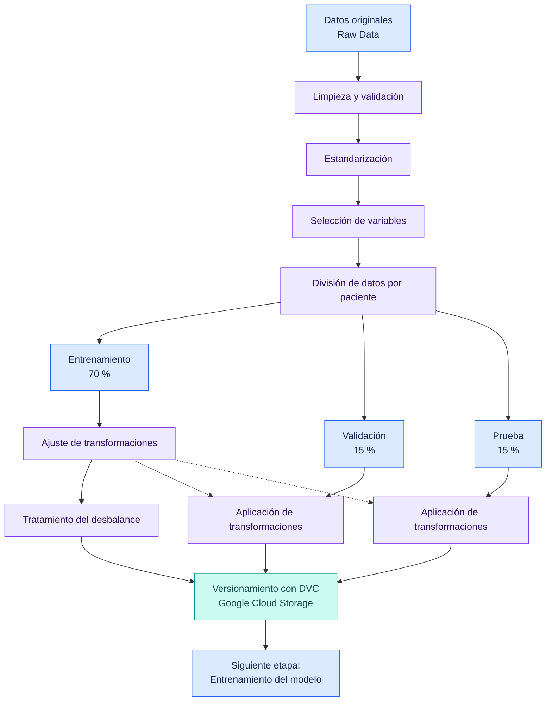

# Reestructuración de un Pipeline para la Predicción de Enfermedades Comunes y Huérfanas

## 1. Introducción

Ahora bien, en la primera unidad se propuso un pipeline orientado a la predicción de enfermedades a partir de los síntomas de los pacientes. Para esta estapa, se busca reestructurar dicho pipeline, incorporando los conceptos de MLOps, con el propósito de garantizar la reproducibilidad, trazabilidad, automatización, despliegue y mantenimiento del modelo a lo largo de su ciclo de vida. La propuesta conserva las etapa del pipeline original pero se amplia su alcance incorporando procesos y tecnología que facilitaran su implementación en un entorno real.

## 2. Objetivos

### 2.1. Objetivo general

Diseñar un pipeline para la predicción de enfermedades comunes y huérfanas, considerando la disponibilidad de datos y garantizando la reproducibilidad, el despliegue y el mantenimiento del modelo.

### 2.2. Objetivos específicos

- Definir un proceso de recolección, almacenamiento y preparación de datos clínicos.
- Definir estrategias de entrenamiento.
- Establecer métricas de evaluación que permitan determinar si el modelo es adecuado para su despliegue.
- Incorporar mecanismos de versionamiento, seguimiento y automatización mediante CI/CD.
- Diseñar alternativas de despliegue local y en la nube que faciliten el acceso al modelo por parte de los médicos.
- Definir mecanismos de monitoreo, reentrenamiento y actualización del modelo.

## 3. Alcance de la propuesta

El proyecto consiste en el diseño de un pipeline que cubra el ciclo de vida completo de un modelo de Machine Learning, desde la recolección de datos hasta el monitoreo y actualización en producción. Se plantea una arquitectura que permita iniciar con una infraestructura sencilla y escalar progresivamente según el volumen de datos y los recursos. 

La solución se presenta como una herramienta de apoyo a la toma de decisiones médicas a partir de la información clínica del paciente y no como un sustituto del diagnóstico realizado por un profesional de la salud.

## 4. Suposiciones del problema

Se establecen las siguientes suposiciones para orientar el diseño del pipeline, dado que no se tienen las características de los datos ni los recursos con los que se cuentan. 

| Suposición | Implicación en el pipeline |
|---|---|
| Se dispone de información clínica histórica de diferentes instituciones médicas. | Necesario estandarizar los datos. |
| Los registros contienen síntomas, características del paciente y diagnósticos confirmados. | Se podrá utilizar un enfoque de aprendizaje supervisado. |
| Mayor cantidad de registros de enfermedades comunes que de enfermedades huérfanas. | Aplicar estrategias para manejar el desbalance y la escasez de datos. |
| Los datos pueden presentar valores faltantes, duplicados e inconsistencias. | Se requiere una etapa de limpieza. |
| La información clínica contiene datos personales sensibles. | Anonimizar datos, implementar un almacenamiento seguro y control de acceso. |
| Los datos clínicos se actualizarán periódicamente. | El pipeline deberá permitir la incorporación de nuevos datos y el reentrenamiento del modelo. |
| Los médicos pueden disponer de diferentes recursos computacionales. | Se contemplarán alternativas de ejecución local y despliegue en la nube. |
| El modelo puede perder capacidad predictiva con el tiempo. | Se deberán establecer mecanismos de monitoreo y actualización. |
| Se cuenta con un equipo de profesionales de salud y de tecnología. | Las decisiones relacionadas con la evaluación y aprobación del modelo deberán realizarse de manera conjunta. |

### 4.1. Características de los datos

Se propone trabajar inicialmente con datos estructurados, organizados en registros clínicos que contengan variables como:

- Edad del paciente.
- Sexo.
- Síntomas presentados.
- Temperatura corporal.
- Intensidad de los síntomas.
- Duración de los síntomas (días).
- Antecedentes médicos relevantes.
- Resultados de exámenes clínicos disponibles.
- Diagnóstico confirmado.

El diagnóstico confirmado será utilizado como variable objetivo durante el entrenamiento, las demás variables como posibles características de entrada, si están disponibles en el momento de realizar la predicción.

### 4.2. Definición del problema de Machine Learning

Se plantea un problema de clasificación supervisada, en el cual el modelo aprende a partir de registros históricos de pacientes con diagnósticos previamente confirmados.

Inicialmente, se asumirá que cada registro cuenta con un diagnóstico principal, por lo que se propone un enfoque de clasificación multiclase. El modelo generará una lista de posibles enfermedades junto con sus probabilidades estimadas, permitiendo al médico considerar diferentes alternativas. En caso de que los datos incluyan múltiples diagnósticos simultáneos por paciente, se deberá evaluar un enfoque de clasificación multietiqueta.

Cuando el modelo no disponga de suficiente información o presente un nivel elevado de incertidumbre, deberá advertir al médico en lugar de generar una predicción concluyente.

## 5. Arquitectura general del pipeline

### 5.1. Diagrama general

*Figura 1. Pipeline.

### 5.2. Funcionamiento general

El proceso inicia con la recolección de información clínica, la cual será almacenada, validada y preparada para el entrenamiento. Luego se evaluará diferentes estrategias de aprendizaje según la disponibilidad de datos de las enfermedades comunes y huérfanas. Los experimentos, parámetros y resultados serán registrados mediante MLflow. Una vez entrenado el modelo, se evaluará su rendimiento. Si el modelo cumple con los criterios técnicos y clínicos, podrá ser desplegado. En el caso que no cumpla, se revisarán los datos y estrategias de entrenamiento. 

La solución podrá ejecutarse mediante Docker o consultarse de manera remota a través de un servicio alojado en la nube. Finalmente, se realizará un seguimiento del funcionamiento del sistema y del rendimiento predictivo del modelo. En caso de detectar cambios relevantes en los datos o una disminución del rendimiento, se evaluará la necesidad de reentrenamiento.

### 5.3. Procesos transversales

Durante todo el ciclo de vida del modelo se tendrán en cuenta los siguientes procesos:

- Versionamiento del código mediante Git y GitHub.
- Versionamiento de datos mediante DVC.
- Seguimiento de experimentos y modelos mediante MLflow.
- Orquestación de tareas mediante Apache Airflow.
- Automatización de pruebas y construcción mediante GitHub Actions.
- Seguridad y privacidad de la información clínica.
- Documentación y trazabilidad de los procesos.

### 5.4. Escalabilidad de la arquitectura

Inicialmente, se propone utilizar Pandas para el procesamiento de datos y Docker para el empaquetado de la solución.

En caso de que el volumen de información supere la capacidad de procesamiento de una sola máquina, se podrá incorporar Apache Spark como alternativa de procesamiento distribuido.

Asimismo, si las necesidades de infraestructura requieren un mayor control sobre la administración y escalabilidad de los contenedores, se podrá considerar Kubernetes como alternativa al servicio administrado de Google Cloud Run.

Estas tecnologías no serán requisitos obligatorios de la implementación inicial, sino alternativas que podrán incorporarse según las necesidades reales del proyecto.

## 6. Etapas del pipeline

### 6.1. Recolección y almacenamiento de datos

#### Suposiciones

| Suposición | Implicación |
|---|---|
| Se tiene acceso a registros clínicos. | Hay acuerdos de acceso y uso de la información. |
| Los registros contienen diagnósticos confirmados. | Permite aplicar aprendizaje supervisado. |
| Las enfermedades huérfanas cuentan con menos registros. | Considerar estrategias de aprendizaje para datos escasos. |
| Las fuentes con diferentes estructuras. | Estandarizar la información. |
| Los datos clínicos son sensibles. | Se deben aplicar mecanismos de privacidad, cifrado y control de acceso. |

#### Descripción del proceso

1. Extraer información de historias clínicas y registros de enfermedades huérfanas.

2. Integrar los registros de las diferentes fuentes mediante y seudonimizarlos. 

3. Almacenar los registros estructurados en PostgreSQL y los archivos de datos en Google Cloud Storage, diferenciando los datos originales (Raw Data) de los datos procesados (Processed Data).

4. Automatizar las cargas periódicas mediante Apache Airflow, incorporando alertas, registros de ejecución y reintentos ante posibles fallos.

#### Diagrama del proceso

*Figura 2. Recolección y almacenamiento de datos.

#### Tecnologías seleccionadas y justificación

| Tecnología | Función | Justificación |
|---|---|---|
| Python | Extracción e integración. | Compatibilidad con el formato de dato. |
| PostgreSQL | Almacenamiento estructurado. | Facilita las consultas SQL. |
| Google Cloud Storage | Almacenamiento de archivos. | Permite almacenar grandes volúmenes de datos. |
| Apache Airflow | Orquestación de la ingesta. | Automatiza las cargas periódicas y facilita el control de fallos. |

### 6.2. Preparación y procesamiento de datos

#### Objetivo

Transformar los datos clínicos recolectados en un conjunto
de datos de calidad, consistente y adecuado para el
entrenamiento y evaluación del modelo.

#### Suposiciones e implicaciones

| Suposición | Implicación |
|---|---|
| Existen valores faltantes, duplicados e inconsistencias. | Se requieren procesos de limpieza y validación. |
| Las variables presentan diferentes formatos y unidades de medida. | Se requiere estandarizar la información clínica. |
| Existe un desbalance entre enfermedades comunes y huérfanas. | Se deben aplicar estrategias para evitar que el modelo favorezca las clases mayoritarias. |
| Un paciente puede tener múltiples registros clínicos. | Se debe evitar que sus registros aparezcan en diferentes conjuntos de entrenamiento y evaluación. |
| Los datos se actualizarán periódicamente. | Se requiere versionamiento para garantizar la reproducibilidad. |

#### Descripción del proceso

1. **Limpieza:** identificar registros duplicados, valores
   faltantes, inconsistencias y valores clínicamente inválidos.
   El tratamiento de los valores faltantes dependerá de la
   naturaleza de cada variable.

2. **Estandarización:** unificar formatos, unidades de medida
   y códigos de enfermedades mediante una clasificación
   clínica común, como la CIE-10.

3. **Selección de variables:** identificar las características
   relevantes para la predicción, excluyendo identificadores
   personales y variables que no estén disponibles al momento
   de realizar la consulta médica.

4. **División de datos:** separar los registros en conjuntos
   de entrenamiento (70 %), validación (15 %) y prueba (15 %).
   La división se realizará por paciente, procurando mantener
   la representación de las diferentes enfermedades.

5. **Transformación:** aplicar codificación de variables
   categóricas, imputación y escalamiento cuando el algoritmo
   lo requiera. Las transformaciones se ajustarán únicamente
   con los datos de entrenamiento.

6. **Tratamiento del desbalance:** evaluar la distribución
   de las enfermedades y considerar la ponderación de clases
   o técnicas de sobremuestreo como SMOTE, únicamente sobre
   los datos de entrenamiento y cuando sean clínicamente
   apropiadas.

7. **Versionamiento:** almacenar los conjuntos de datos
   procesados en Google Cloud Storage y gestionar sus
   versiones mediante DVC.

Apache Airflow coordinará la ejecución de estas tareas.
Los procesos de transformación deberán ser reproducibles
y reutilizables durante el entrenamiento y la predicción.

#### Diagrama del proceso

*Figura 3. Preparación y procesamiento de datos.

#### Tecnologías seleccionadas y justificación

| Tecnología | Función | Justificación |
|---|---|---|
| Python y Pandas | Limpieza y transformación. | Facilitan la manipulación de datos estructurados. |
| Scikit-learn | División, imputación y transformación. | Permite construir procesos de preprocesamiento reproducibles. |
| Imbalanced-learn | Tratamiento del desbalance. | Proporciona técnicas de sobremuestreo y submuestreo. |
| DVC | Versionamiento de datos. | Garantiza la trazabilidad de los conjuntos utilizados. |
| Apache Airflow | Orquestación. | Automatiza y controla la ejecución de las tareas. |
| Apache Spark (opcional) | Procesamiento distribuido. | Permite procesar datos que superen la capacidad de una sola máquina. |

#### Resultado esperado

Conjuntos de datos de entrenamiento, validación y prueba
limpios, transformados, versionados y disponibles para
el desarrollo y evaluación del modelo, evitando la fuga
de información (data leakage).

